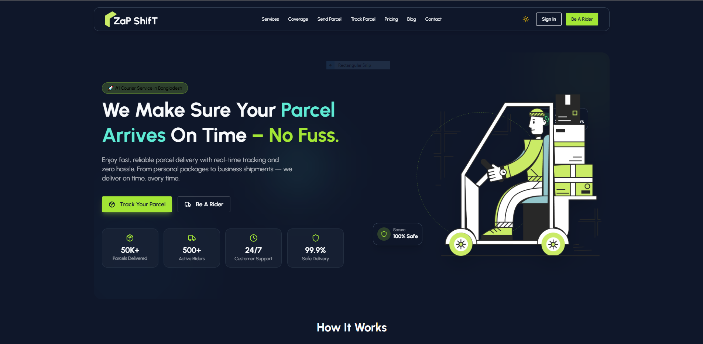
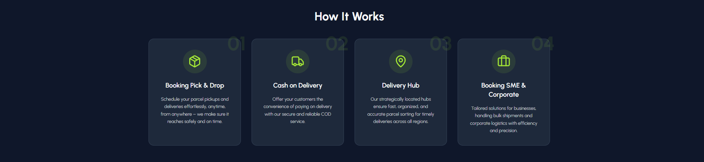
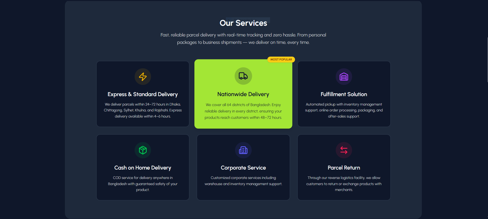
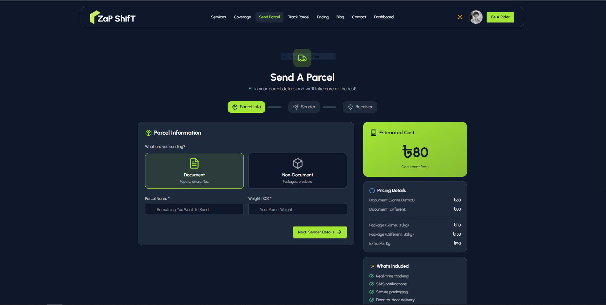
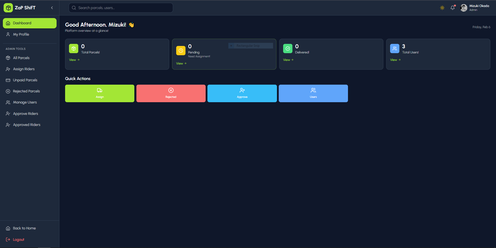
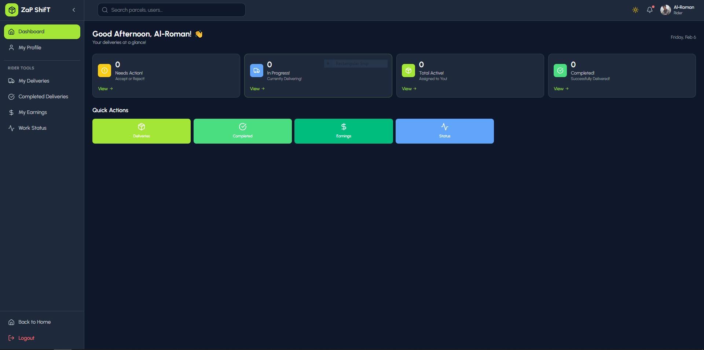
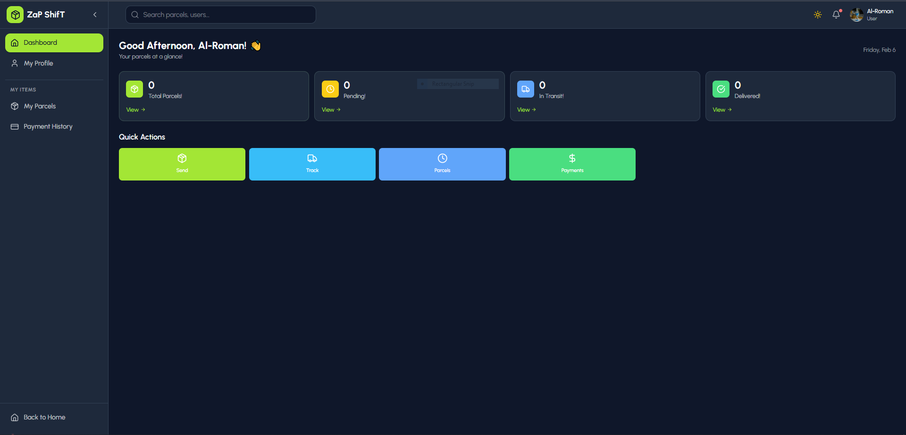

# ⚡ ZapShift - Parcel Delivery Platform (Client)



## 📌 Project Overview

**ZapShift** is a comprehensive, full-stack parcel delivery management platform designed to streamline logistics for senders, riders, and administrators. Built with a modern tech stack, it facilitates seamless parcel booking, real-time tracking, secure payments, and role-based management.

This client-side application serves as the interface for all user interactions, ensuring a smooth and responsive experience across devices.

🌐 **Live Application:** [https://zapshiftcourier.web.app/](https://zapshiftcourier.web.app/)


---

## 📸 App Glimpses

<div align="center">
  
  
  
  
  
  
  
</div>

---

## 🎯 Key Features

### 🔐 Authentication & Security
- **Secure Login/Signup:** Email/Password authentication via Firebase.
- **Social Login:** One-click Google Sign-In integration.
- **Role-Based Access Control (RBAC):** Protected routes ensuring Users, Riders, and Admins only access authorized areas.
- **JWT Authorization:** Secure API communication with JSON Web Tokens.

### 📦 Parcel Management
- **Intuitive Booking:** Step-by-step form for parcel booking with weight-based price calculation.
- **Real-Time Tracking:** Unique tracking ID system with visual timeline updates (Pending -> Delivered).
- **Service Center Locator:** Interactive map integration for selecting drop-off/pickup points.

### 💳 Payments & Finance
- **Stripe Integration:** Secure payment gateway for hassle-free transactions.
- **Payment History:** Detailed log of all user transactions.
- **Earnings Tracker:** Dashboard for riders to monitor their earnings.

### 📊 Role-Based Dashboards
- **User (Sender):** Manage bookings, track parcels, and view payment history.
- **Rider:** View assigned tasks, update delivery status, and track earnings.
- **Admin:** Comprehensive oversight of users, riders, parcels, and platform statistics.

### 🎨 User Experience
- **Responsive Design:** Fully optimized for Mobile, Tablet, and Desktop.
- **Dark/Light Mode:** Theme toggle for user preference.
- **Interactive UI:** Framer Motion animations, Swiper carousels, and Toast notifications for feedback.

---

## 🛠 Tech Stack

### Frontend Core
- **React 19:** Component-based UI architecture.
- **Vite:** Next-generation frontend tooling for fast builds.
- **React Router 7:** Dynamic client-side routing.

### State Management & Data Fetching
- **TanStack Query (React Query):** Efficient server-state management, caching, and synchronization.
- **Axios:** Promise-based HTTP client for API requests.
- **React Context API:** Global state management for authentication and themes.

### Styling & UI Components
- **Tailwind CSS 4:** Utility-first CSS framework for rapid styling.
- **DaisyUI 5:** Component library for Tailwind.
- **Framer Motion:** Production-ready animation library.
- **React Leaflet:** Interactive maps.
- **React Hook Form:** Performant form validation and handling.

### Services & Integrations
- **Firebase Authentication:** Identity platform for secure user management.
- **Stripe:** Payment processing platform.
- **EmailJS:** Client-side email service for contact forms.

---

## 🚀 Installation & Setup

Follow these steps to run the client application locally.

### Prerequisites
- Node.js (v18 or higher)
- npm or yarn

### 1. Clone the Repository
```bash
git clone https://github.com/Al-Roman23/zapshift-client.git
cd zapshift-client
```

### 2. Install Dependencies
```bash
npm install
```

### 3. Configure Environment Variables
Create a `.env` file in the root directory and add your configuration credentials:

```env
VITE_API_URL=http://localhost:5000
VITE_FIREBASE_API_KEY=your_firebase_api_key
VITE_FIREBASE_AUTH_DOMAIN=your_auth_domain
VITE_FIREBASE_PROJECT_ID=your_project_id
VITE_FIREBASE_STORAGE_BUCKET=your_storage_bucket
VITE_FIREBASE_MESSAGING_SENDER_ID=your_sender_id
VITE_FIREBASE_APP_ID=your_app_id
VITE_STRIPE_PUBLIC_KEY=your_stripe_public_key
VITE_EMAILJS_SERVICE_ID=your_emailjs_service
VITE_EMAILJS_TEMPLATE_ID=your_emailjs_template
VITE_EMAILJS_PUBLIC_KEY=your_emailjs_public_key
```

### 4. Run Development Server
```bash
npm run dev
```
The application will be available at `http://localhost:5173`.

### 5. Build for Production
```bash
npm run build
```

---

## 📂 Project Structure

```
src/
├── assets/          # Static assets (images, icons)
├── components/      # Reusable UI components
├── contexts/        # React Context providers (Auth, Theme)
├── hooks/           # Custom React hooks (useAxiosSecure, useAuth)
├── layouts/         # Layout components (Main, Dashboard)
├── pages/           # Application pages
│   ├── Auth/        # Authentication pages
│   ├── Dashboard/   # Role-specific dashboard views
│   ├── Home/        # Landing page sections
│   └── Shared/      # Shared page components (Navbar, Footer)
├── routes/          # Navigation and route definitions
├── utils/           # Utility functions and constants
└── main.jsx         # Application entry point
```

---

## � Related Repositories

- **Server Repository:** [GitHub Link](https://github.com/Al-Roman23/zapshift-server.git)
- **Live Site:** [https://zapshiftcourier.web.app/](https://zapshiftcourier.web.app/)

---

## 👨‍💻 Author

**Al-Roman Molla**  
Backend-Focused Full Stack Developer

- **Email:** alromanmolla@gmail.com
- **LinkedIn:** [Profile](https://www.linkedin.com/in/al-roman/)

---

Made with ❤️ by Al-Roman!
